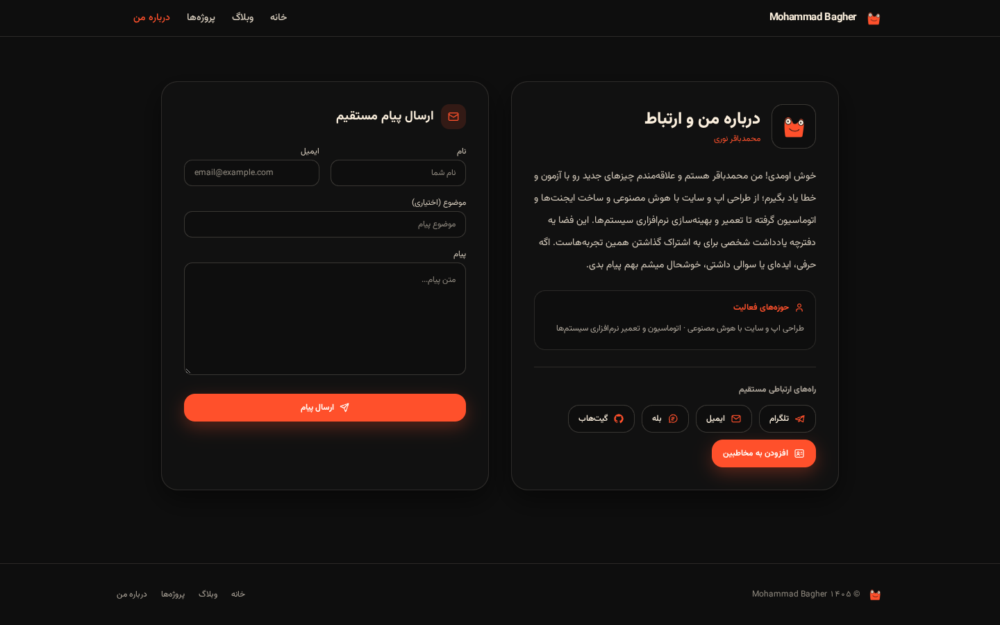

<div align="center">


# Mohammad Bagher — Personal Portfolio & Local-First Blog (`mbnd.ir`)

**پورتفولیو، وبلاگ شخصی و سیستم مدیریت محتوای اختصاصی با معماری محلی (Iran-First & Local-First)**

[](#tech-stack)
[](#tech-stack)
[](#tech-stack)
[](#tech-stack)
[](#deployment--cloudflare)
[](./LICENSE)

[نسخه فارسی](#-معرفی-پروژه-فارسی) · [English Overview](#-overview-english) · [Screenshots](#-screenshots--تصاویر-محیط-سایت) · [SEO & AI Search](#-seo--ai-search-optimization) · [Deployment & Cloudflare](#-deployment--cloudflare) · [License](#-license)

</div>

---

## 📸 Screenshots / تصاویر محیط سایت

| صفحه اصلی (`mbnd.ir`) | صفحه نوشته با بلوک کد، زمان مطالعه و اشتراک‌گذاری |
| :---: | :---: |
|  |  |

| صفحه درباره من و فرم ارتباط یکپارچه |
| :---: |
|  |

---

## 🇮🇷 معرفی پروژه (فارسی)

وب‌سایت شخصی و وبلاگ **محمدباقر (`mbnd.ir`)** یک اپلیکیشن فول‌استک، سریع و کاملاً خودکفاست که بدون هیچ وابستگی به CDN یا سرویس خارجی (مثل Google Fonts یا Firebase) طراحی شده تا حتی روی اینترنت ضعیف و ناپایدار ایران در کسری از ثانیه بارگذاری شود.

### ویژگی‌های کلیدی
- **معماری صددرصد محلی (Local-First & Iran-First):**
  - فونت محلی `Vazirmatn` با فرمت سبک `woff2` و پیش‌بارگذاری (`preload`) و آیکون‌های SVG داخلی بدون درخواست خارجی.
  - پایگاه داده محلی **SQLite** (با حالت WAL) و ذخیره تمام تصاویر/رسانه‌ها روی دیسک سرور همراه با فشرده‌سازی خودکار WebP (`ffmpeg`).
  - فشرده‌سازی پاسخ‌های سرور با **Brotli (`br`) و Gzip**، لود تدریجی کد صفحات (Code Splitting)، و نمایش فوری پوستر سبک پیش از بارگذاری ویدیو (با احترام به حالت Save-Data و اینترنت 2G).
- **شخصی‌سازی کامل از داخل پنل مدیریت:**
  - ویرایش تمام متون سایت، جایگزینی/حذف/آپلود لوگو، فاوآیکون، ویدیو و پوستر دسکتاپ و موبایل لندینگ‌پیج.
  - مدیریت کامل تب‌های منو و پاورقی (افزودن، ویرایش، مخفی‌کردن، حذف و جابه‌جایی با Drag & Drop).
  - کنترل نمایش یا مخفی‌سازی تک‌تک بخش‌ها، فرم تماس، زمان مطالعه مقالات و دکمه‌های اشتراک‌گذاری (کپی لینک، تلگرام، واتساپ، ایکس، اشتراک مستقیم).
- **تم تیره / روشن / خودکار + پالت رنگ اختصاصی یکپارچه با پنل مدیریت:**
  - پالت پیش‌فرض برگرفته از لوگو (`#0E0E0E`، `#121212`، `#FBEFDD`، `#FF502B`) با امکان ویرایش کامل ۷ رنگ اصلی؛ هر تغییری در حالت تم یا رنگ‌ها به صورت زنده هم روی سایت عمومی و هم روی تمام بخش‌های پنل مدیریت اعمال می‌شود.
  - دکمه تغییر تم در هدر به صورت پیش‌فرض خاموش است و هر زمان بخواهی از بخش «ظاهر و چیدمان» پنل مدیریت قابل فعال‌سازی است.
- **معماری دوزبانه کامل فارسی / انگلیسی (اختیاری و پیش‌فرض خاموش):**
  - سایت به صورت پیش‌فرض تک‌زبانه **فارسی (RTL)** است و دکمه تغییر زبان خاموش است تا محیط کاملاً یکدست بماند؛ هر زمان نیاز بود از تنظیمات «ظاهر و چیدمان» پنل مدیریت قابل فعال‌سازی است.
  - پشتیبانی کامل دوزبانه در دیتابیس برای تمام نوشته‌ها (عنوان، خلاصه و تک‌تک بلوک‌ها)، دسته‌بندی‌ها، پروژه‌ها، تب‌های منو، شبکه‌های اجتماعی، متون سایت و حتی **خود پنل مدیریت (FA/EN)** با قابلیت ترجمه تک‌کلیکی هوشمند به انگلیسی طبیعی از داخل پنل.
- **ویرایشگر بلوکی پیشرفته وبلاگ + دستیار هوش مصنوعی اختیاری:**
  - پشتیبانی از ۱۲ نوع بلوک (تیتر، پاراگراف با فرمت **بولد**، *کج*، ==هایلایت==، کد، لینک، تصویر، ویدیوی محلی یا یوتیوب/آپارات، صوت، کارت نکته، دکمه، لینک کارت، نقل‌قول و بلوک کد با دکمه کپی) به همراه پشتیبانی `dir="auto"` برای نوشته‌های حاوی متن انگلیسی.
  - محاسبه خودکار زمان مطالعه هر مقاله و نوار اشتراک‌گذاری در انتهای نوشته‌ها.
  - دستیار هوش مصنوعی اختیاری برای تولید، ویرایش و ترجمه محتوا (با پشتیبانی از Gemini و ارائه‌دهندگان OpenAI-Compatible و ذخیره رمزنگاری‌شده کلید API با AES-256-GCM).
- **کارت مخاطب هوشمند (`vCard 3.0`):**
  - ذخیره مستقیم اطلاعات تماس و عکس پروفایل روی گوشی با یک کلیک و قابل ویرایش کامل از پنل مدیریت.
- **امنیت واقعی و آماده برای GitHub (بدون هیچ رمز یا مسیر پیش‌فرض):**
  - هیچ نام کاربری، رمز عبور یا مسیر ادمین پیش‌فرضی داخل سورس‌کد وجود ندارد.
  - پنل مدیریت تا زمانی که `ADMIN_ROUTE` را در فایل `.env` سرور تنظیم نکنی کاملاً غیرفعال است و در اولین ورود، فرم **«راه‌اندازی اولیه حساب مدیر»** فقط یک بار نمایش داده می‌شود و پس از ساخت حساب برای همیشه قفل می‌گردد.
  - رمزنگاری رمز عبور با `scrypt`، کوکی `HttpOnly` امضاشده با HMAC-SHA256، بررسی امنیتی مبدا (CSRF)، محدودیت تلاش ورود (Rate Limiting سازگار با Cloudflare)، قابلیت تغییر نام کاربری/رمز (حداقل ۸ کاراکتر) و باطل‌کردن نشست‌های فعال.

---

## 🌍 Overview (English)

**`mbnd.ir`** is a lightweight, self-hosted full-stack personal portfolio, block-based blog, and custom CMS built for maximum reliability, SEO clarity, and speed under constrained or high-latency networks.

### Highlights
- **Zero External Runtime Dependencies:** Local `Vazirmatn` `.woff2` fonts (with `<link rel="preload">`), inline SVG icons, embedded SQLite (`better-sqlite3` in WAL mode), local media upload pipeline with automatic WebP optimization, and built-in **Brotli / Gzip** response compression.
- **Full Visual, Structural & Theme-Synced CMS:** Customize hero desktop/mobile videos & posters, logo, favicon, navigation tabs (drag-and-drop), section toggles, per-button share bar controls, vCard contact file, and Dark/Light/Auto color palettes — theme & palette updates live-sync across both the public site and the entire Admin Portal (header theme & language toggles stay off by default and are opt-in from Admin).
- **Save-Time Bilingual FA/EN Support (Opt-In):** Persian (`RTL`) by default with zero mixed-language leaks when English (`LTR`) is enabled — structured English fields in SQLite for every post (title, excerpt, and all 12 block types), category, project, social label, nav tab, and site copy, plus a bilingual Admin Portal and one-click AI translation.
- **Block-Based Blog Editor:** 12 structured content blocks with inline rich formatting, local/YouTube/Aparat embeds, automatic reading time, share bar, `dir="auto"` mixed-script support, and an optional bring-your-own-key AI assistant (encrypted at rest with AES-256-GCM).
- **Zero Hardcoded Secrets & First-Run Setup:** No default passwords, usernames, or admin paths exist in the repository. Setting `ADMIN_ROUTE` in `.env` activates the portal, and on a fresh database a one-time atomic First-Run Admin Setup creates your account and permanently locks itself.

---

## 🔍 SEO & AI Search Optimization

- **Server-Side Dynamic Meta & OpenGraph Tags:** Every route (`/`, `/blog`, `/blog/:slug`, `/projects`, `/about`) injects accurate `<title>`, `<meta name="description">`, `<link rel="canonical">`, `og:*`, and `twitter:card` tags on the server.
- **Rich Structured Data (Schema.org JSON-LD):** Automatic `WebSite`, `Person` (with `knowsAbout` & `sameAs`), `Blog`, `BlogPosting` (with `timeRequired`, `wordCount`, `articleSection`), `CollectionPage`/`ItemList`, `ProfilePage`, and `BreadcrumbList`.
- **AI Search & LLM Indexing (`/llms.txt` & `/llms-full.txt`):** Clean dynamic Markdown indexes for AI search engines (ChatGPT Search, Perplexity, Claude, Gemini) alongside `/robots.txt` (never exposing the secret admin path) and `/sitemap.xml` with `<lastmod>`.
- **True HTTP `404` & `noindex`:** Unknown routes and unpublished slugs return real `404 Not Found` status with `<meta name="robots" content="noindex, nofollow" />`.
- **Web App Manifest:** Local `/manifest.webmanifest` for clean browser/mobile installation metadata.

---

## 🛠 Tech Stack

| Layer | Technology |
| :--- | :--- |
| **Frontend** | React 19, TypeScript, Vite, Tailwind CSS v4, React Router v7, Lucide Icons |
| **Backend** | Node.js 22, Express 4, Native `zlib` (Brotli/Gzip), Multer, SSR Meta/JSON-LD Injection |
| **Database** | Embedded SQLite (`better-sqlite3` in WAL mode) — zero external database required |
| **Media** | Local disk uploads (`/public/uploads`) + `ffmpeg` WebP optimization & vCard avatar encoding |
| **Testing** | Built-in `node:test` + `tsx` unit test suite (`src/lib/cms.test.ts`, `server/auth.test.ts`) |

---

## 🚀 Local Setup / اجرای محلی

```bash
# 1. Clone the repository
git clone https://github.com/mbndCoder/<your-repo>.git
cd <your-repo>

# 2. Install dependencies
npm install

# 3. Create your local environment file & set a secret ADMIN_ROUTE
cp .env.example .env
# Edit .env and set ADMIN_ROUTE="your-secret-slug"

# 4. Run in development mode (http://localhost:3000)
npm run dev

# 5. Build & start in production mode
npm run build
npm start
```

### فعال‌سازی پنل مدیریت در اولین اجرا
1. در فایل `.env` یک مسیر مخفی دلخواه برای `ADMIN_ROUTE` بگذار (مثلاً `ADMIN_ROUTE="my-secret-portal-94"`).
2. سرور را اجرا کن و به آدرس `https://mbnd.ir/<ADMIN_ROUTE>` برو.
3. در اولین ورود (وقتی هنوز هیچ کاربری در دیتابیس نیست)، فرم **«راه‌اندازی اولیه حساب مدیر»** نمایش داده می‌شود؛ نام کاربری و رمز عبور دلخواهت را ثبت کن تا حسابت به صورت امن ساخته و فرم راه‌اندازی برای همیشه قفل شود.

### Run Unit Tests / اجرای تست‌ها

```bash
npx tsx --test src/lib/cms.test.ts server/auth.test.ts
npm run lint
```

---

## ⚙️ Environment Variables (`.env.example`)

All sensitive values live strictly in `.env` (ignored by Git via `.gitignore`). Never commit `.env` or `data/` to Git.

| Variable | Description |
| :--- | :--- |
| `APP_URL` | Public canonical domain (e.g. `https://mbnd.ir`) used for SEO, JSON-LD, sitemap, `/llms.txt`, and vCard |
| `APP_PORT` | HTTP port the Node.js server listens on (default: `3000`) |
| `NODE_ENV` | `development` or `production` |
| `ADMIN_ROUTE` | **Required to enable Admin Portal.** Secret URL slug without leading slash (portal stays disabled if blank) |
| `ADMIN_USERNAME` | Optional initial admin username (leave blank to use First-Run Setup UI) |
| `ADMIN_PASSWORD` | Optional initial admin password (leave blank to use First-Run Setup UI) |
| `ADMIN_PASSWORD_HASH` | Optional pre-hashed `scrypt` (`salt:hash`) alternative to plaintext password |
| `SESSION_SECRET` | Optional 64-char HMAC secret (auto-generated and stored securely in SQLite if left blank) |
| `DB_PATH` | Path to the SQLite database file (default: `./data/site.db`) |
| `UPLOAD_DIR` | Directory for uploaded media files (default: `./public/uploads`) |

---

## ☁️ Deployment & Cloudflare

This repository ships with a multi-stage production `Dockerfile` (`node:22-bookworm-slim` + `ffmpeg` + built-in `/api/health` check).

### Docker / VPS with Persistent Storage

Mount `/app/data` (SQLite database) and `/app/public/uploads` (uploaded media) as persistent volumes so updates or container restarts never delete posts or files:

```bash
docker build -t mbnd-site .
docker run -d \
  --name mbnd-site \
  --restart unless-stopped \
  -p 127.0.0.1:3000:3000 \
  --env-file .env \
  -v $(pwd)/data:/app/data \
  -v $(pwd)/public/uploads:/app/public/uploads \
  mbnd-site
```

### Cloudflare (`mbnd.ir`) Recommendations
- **Tunnel (`cloudflared`)** or reverse proxy (`Caddy`/`Nginx`) forwarding `https://mbnd.ir` -> `http://127.0.0.1:3000`.
- **SSL/TLS Mode:** `Full (strict)` with **Always Use HTTPS** enabled.
- **Speed & Caching:** Enable **Brotli** and **HTTP/3 (QUIC)**. Static assets (`/assets/*`, `/fonts/*`, `/uploads/*`) already send immutable cache headers while HTML and `/api/*` send `no-store` / `no-cache` so newly published or deleted blog posts appear immediately without stale cache issues.
- **Health Check Endpoint:** `GET /api/health` returns `200 OK` JSON.

---

## 📄 License

Licensed under the **Apache License, Version 2.0** — see the [`LICENSE`](./LICENSE) file for full details.

Copyright © 2026 **Mohammad Bagher (`mbnd.ir`)**.
