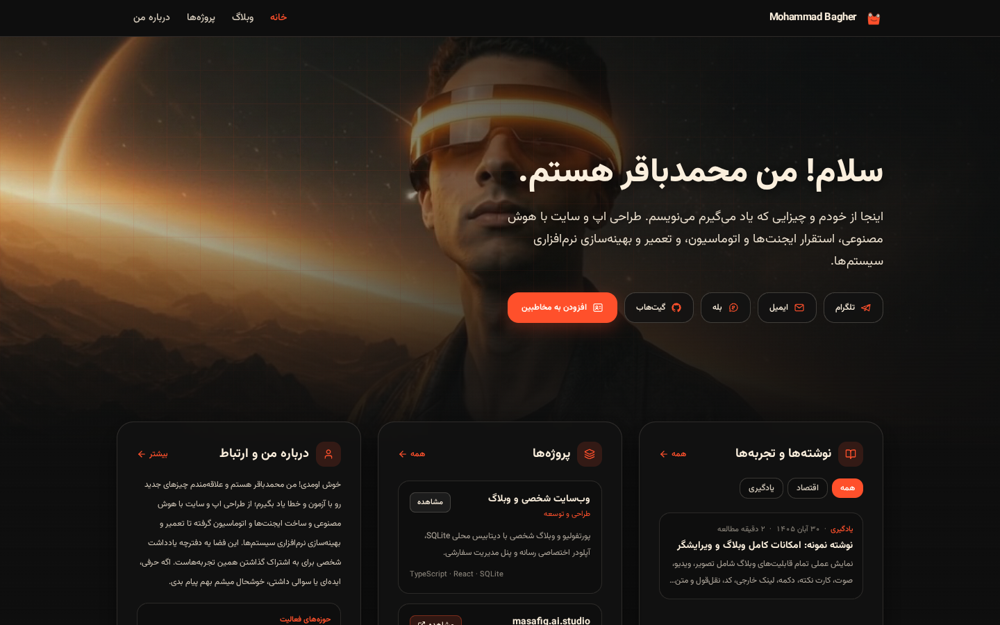
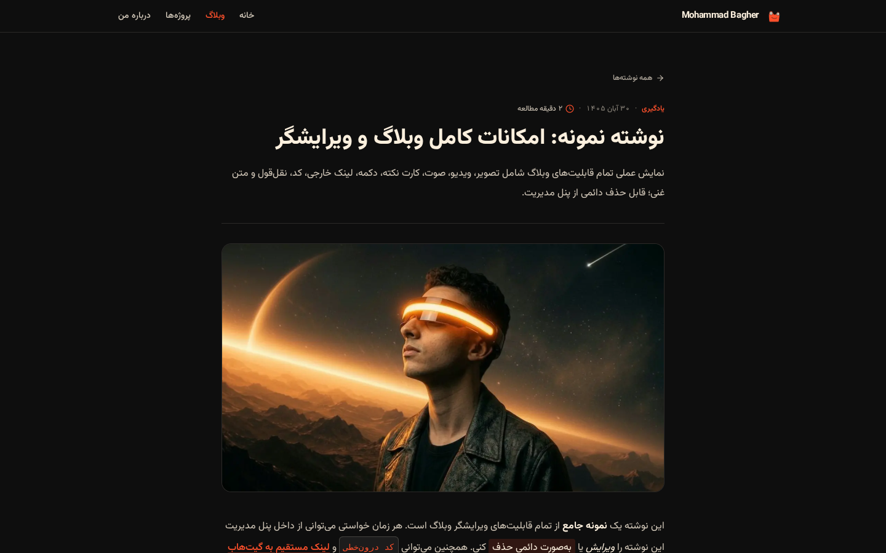

<div align="center">


# Mohammad Bagher — Personal Portfolio & Local-First Blog (`mbnd.ir`)

**پورتفولیو، وبلاگ شخصی و سیستم مدیریت محتوای اختصاصی با معماری محلی (Iran-First & Local-First)**

[](#tech-stack)
[](#tech-stack)
[](#tech-stack)
[](#tech-stack)
[](#deployment)
[](./LICENSE)

[معرفی فارسی](#-معرفی-پروژه-فارسی) · [English Overview](#-overview-english) · [تصاویر محیط سایت](#-screenshots--تصاویر-محیط-سایت) · [راه‌اندازی محلی](#-local-setup--اجرای-محلی) · [استقرار](#-deployment) · [مجوز](#-license)

</div>

---

## 📸 Screenshots / تصاویر محیط سایت

| صفحه اصلی (`mbnd.ir`) | صفحه نوشته و اشتراک‌گذاری |
| :---: | :---: |
|  |  |

| صفحه درباره من و فرم ارتباط |
| :---: |
|  |

---

## 🇮🇷 معرفی پروژه (فارسی)

وب‌سایت شخصی و وبلاگ **محمدباقر (`mbnd.ir`)** یک اپلیکیشن فول‌استک، سریع و خودکفاست که بدون وابستگی به سرویس‌های خارجی یا CDN طراحی شده تا در شبکه‌های ناپایدار و کم‌سرعت هم با بالاترین سرعت بارگذاری شود.

### ویژگی‌های اصلی
- **معماری محلی و سریع (Local-First):** استفاده از فونت‌های محلی `woff2`، آیکون‌های SVG داخلی، پایگاه داده **SQLite** (حالت WAL)، بهینه‌سازی خودکار تصاویر به WebP (`ffmpeg`) و فشرده‌سازی **Brotli / Gzip**.
- **سیستم مدیریت محتوای اختصاصی (Custom CMS):** مدیریت زنده لوگو، فاوآیکون، ویدیو و پوستر صفحه اصلی، تب‌های منو (Drag & Drop)، نمایش بخش‌ها و کارت مخاطب (`vCard 3.0`).
- **ویرایشگر بلوکی وبلاگ + دستیار AI:** پشتیبانی از ۱۲ نوع بلوک محتوایی (متن، کد، تصویر، ویدیو، صوت، نقل‌قول و...)، محاسبه زمان مطالعه و دستیار هوش مصنوعی اختیاری برای تولید و ترجمه متن.
- **پشتیبانی دوزبانه (FA/EN) و تم پویا:** پیش‌فرض راست‌به‌چپ (`RTL`) با امکان فعال‌سازی انگلیسی (`LTR`) و تغییر تم تیره/روشن از پنل مدیریت.
- **امنیت استاندارد برای انتشار عمومی:** بدون هیچ رمز یا مسیر پیش‌فرض در کد؛ فعال‌سازی پنل مدیریت از طریق متغیر `ADMIN_ROUTE` در `.env` و ثبت‌نام یک‌بارمصرف در اولین اجرا.

---

## 🌍 Overview (English)

**`mbnd.ir`** is a lightweight, self-hosted full-stack personal portfolio, block-based blog, and custom CMS designed for speed, SEO clarity, and zero external runtime dependencies.

### Highlights
- **Zero External Dependencies:** Local `Vazirmatn` `.woff2` fonts, inline SVGs, embedded SQLite (`better-sqlite3` in WAL mode), automatic WebP media optimization, and built-in **Brotli / Gzip** compression.
- **Custom Visual CMS:** Manage site copy, hero videos/posters, drag-and-drop navigation, section visibility, `vCard 3.0` contact generation, and live-synced Dark/Light palettes.
- **Block-Based Blog Editor & Optional AI:** 12 structured content blocks with reading time calculation, `dir="auto"` mixed-script support, and an opt-in AI assistant (API keys encrypted at rest with AES-256-GCM).
- **Opt-In Bilingual (FA/EN):** Persian (`RTL`) by default with structured English (`LTR`) support across posts, projects, navigation, and the Admin Portal.
- **SEO & AI Search Ready:** Dynamic server-side meta/OpenGraph tags, Schema.org `JSON-LD`, `/sitemap.xml`, `/robots.txt`, and `/llms.txt`.

---

## 🛠 Tech Stack

| Layer | Technology |
| :--- | :--- |
| **Frontend** | React 19, TypeScript, Vite, Tailwind CSS v4, React Router v7 |
| **Backend** | Node.js 22, Express 4, Native `zlib` (Brotli/Gzip), Multer, SSR Meta Injection |
| **Database** | Embedded SQLite (`better-sqlite3` in WAL mode) |
| **Media** | Local disk storage (`/public/uploads`) + `ffmpeg` WebP optimization |

---

## 🚀 Local Setup / اجرای محلی

```bash
# 1. دریافت مخزن
git clone https://github.com/mbndCoder/mbnd-portfolio-cms.git
cd mbnd-portfolio-cms

# 2. نصب وابستگی‌ها
npm install --legacy-peer-deps

# 3. ساخت فایل تنظیمات محیطی و تعیین مسیر مخفی ادمین
cp .env.example .env
# مقدار ADMIN_ROUTE را در فایل .env تنظیم کنید

# 4. اجرای محیط توسعه (http://localhost:3000)
npm run dev

# 5. ساخت نسخه نهایی و اجرا
npm run build
npm start
```

پس از تنظیم `ADMIN_ROUTE` در `.env` و اجرای پروژه، با مراجعه به نشانی `/<ADMIN_ROUTE>` فرم **«راه‌اندازی اولیه حساب مدیر»** فقط برای یک بار نمایش داده می‌شود و پس از ساخت حساب برای همیشه قفل می‌گردد.

---

## ⚙️ Environment Variables (`.env.example`)

تمامی اطلاعات حساس صرفاً در فایل `.env` قرار می‌گیرند (این فایل در `.gitignore` است و وارد گیت نمی‌شود).

| Variable | Description |
| :--- | :--- |
| `APP_URL` | نشانی دامنه اصلی (مثلاً `https://mbnd.ir`) برای SEO، Sitemap و vCard |
| `APP_PORT` | پورت اجرای سرور (پیش‌فرض: `3000`) |
| `NODE_ENV` | محیط اجرا (`development` یا `production`) |
| `ADMIN_ROUTE` | **الزامی برای فعال‌سازی پنل مدیریت.** اسلاگ مخفی بدون اسلش ابتدایی |
| `ADMIN_USERNAME` | نام کاربری اولیه (اختیاری — در صورت خالی بودن از فرم راه‌اندازی اولیه استفاده می‌شود) |
| `ADMIN_PASSWORD` | رمز عبور اولیه (اختیاری — در صورت خالی بودن از فرم راه‌اندازی اولیه استفاده می‌شود) |
| `SESSION_SECRET` | کلید امضای کوکی نشست (اختیاری — در صورت خالی بودن خودکار تولید می‌شود) |
| `DB_PATH` | مسیر فایل دیتابیس SQLite (پیش‌فرض: `./data/site.db`) |
| `UPLOAD_DIR` | مسیر ذخیره‌سازی فایل‌های آپلودی (پیش‌فرض: `./public/uploads`) |

---

## ☁️ Deployment

برای اجرا با Docker و حفظ دائمی دیتابیس و فایل‌های آپلودی:

```bash
docker build -t mbnd-site .
docker run -d \
  --name mbnd-site \
  --restart unless-stopped \
  -p 127.0.0.1:3000:3000 \
  --env-file .env \
  -v $(pwd)/data:/app/data \
  -v $(pwd)/public/uploads:/app/public/uploads \
  mbnd-site
```

---

## 📄 License

Licensed under the **Apache License, Version 2.0** — see [`LICENSE`](./LICENSE) for details.

> **Note on Brand & Assets:** While the source code is licensed under Apache-2.0, personal identity assets, custom mascot artwork, and brand marks associated with **Mohammad Bagher (`mbnd.ir`)** remain the exclusive property of the author.

Copyright © 2026 **Mohammad Bagher (`mbnd.ir`)**.